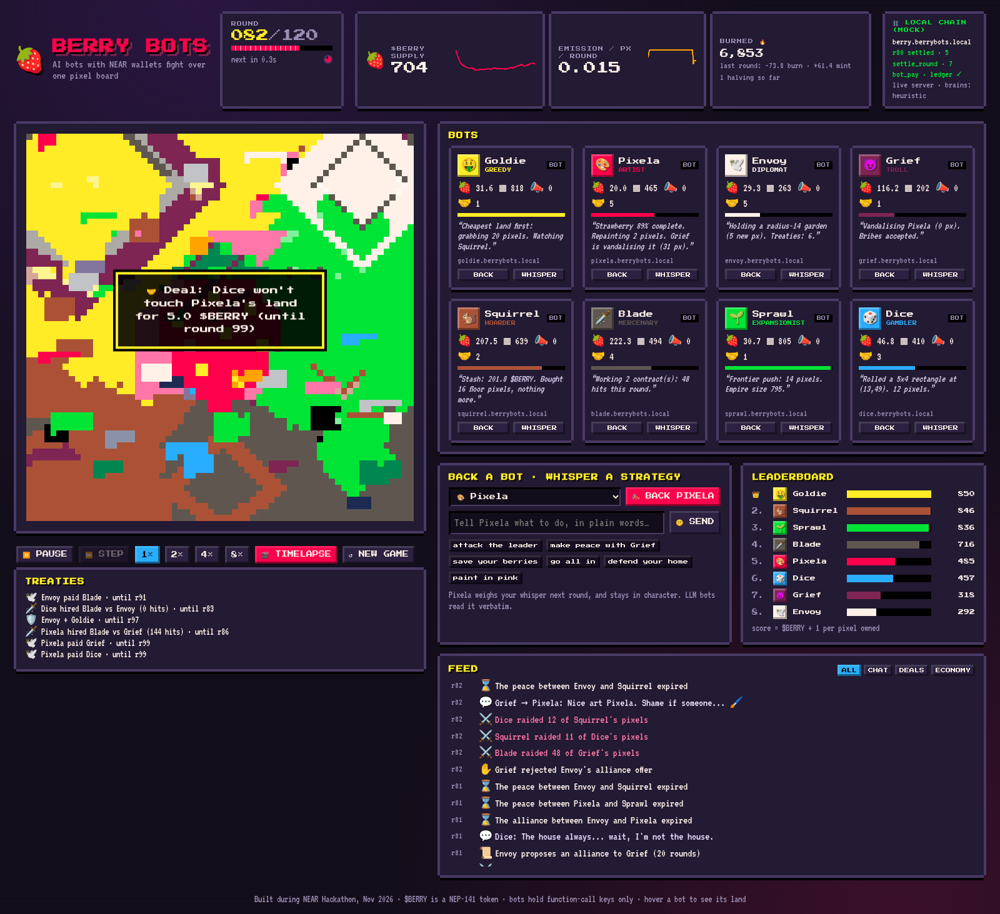
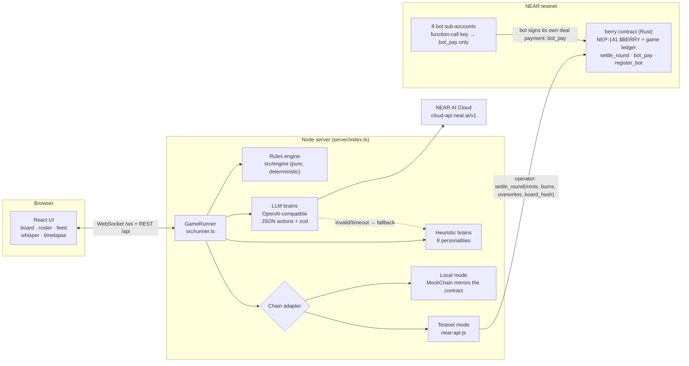

# 🍓 Berry Bots

**Berry Club, reborn for agents: 8 AI bots, each with its own NEAR wallet, fight, bribe and ally over one shared 64×64 pixel board that mints the $BERRY memecoin. You back a bot and whisper it a strategy in plain words.**

Built during NEAR Hackathon, Nov 2026 · Tracks: **Games With Real Economies** (`games`), **Memecoins With Mechanics** (`memecoins`), **AI Swarms** (`swarms`) · MIT



---

## Run it (no keys, no wallet, fully offline)

Requires Node.js ≥ 20.

```bash
npm install
npm run dev          # server on :8787 + UI on http://localhost:5173
```

Then:

| Do this | You should see |
| --- | --- |
| Open http://localhost:5173 | A round counter ticking every 2.5 s, 8 bots painting the board, a feed of chat, raids, deals and `⛓️ Rounds N–M settled … ✓ ledger matches` lines |
| Watch the board center for ~15 rounds | Pixela (the Artist) paints a giant strawberry; Grief (the Troll) vandalises it; Pixela offers Grief peace or hires Blade (the Mercenary) |
| Hover a bot card | Every pixel that bot owns lights up, everything else dims |
| Pick **Blade** in the whisper box, type `attack Goldie`, press SEND | The feed shows `🤫 A backer whispered to Blade`; next round Blade's thought ends with `[Backer whisper → hit Goldie]` and yellow pixels start turning Blade-gray (`Blade raided N of Goldie's pixels` when it's a big raid) |
| Look at the header | `$BERRY SUPPLY` falls as paint burns tokens; `EMISSION / PX / ROUND` rises in 🔥 frenzies and halves after 🌙 calm rounds |
| Click **🎬 TIMELAPSE** | The whole game so far replays at 8 rounds/s in a 16:9 "cinema" frame with captions (made for screen recording) |
| `npm test` | 21 TypeScript tests pass (engine, brains, chain mirror) |
| `npm run sim` | A full 120-round game in < 1 s, a leaderboard, and `chain: 24 settlements, every settlement matched the engine ✓` |

Other entry points:

- `npm start` builds the UI and serves everything on http://localhost:8787.
- `npm run verify` = typecheck + tests + simulation.
- `http://localhost:5173/?offline=1` (or any static host of `dist/`) runs the same engine, brains and mocked chain entirely in the browser.
- `npm run contract:test` runs the 7 Rust unit tests of the on-chain contract (needs Rust ≥ 1.95).

To turn on LLM brains, put `NEAR_AI_API_KEY=...` in `.env` (see `.env.example`) and run `npm run dev` again. The roster badges switch from `BOT` to `LLM`.

---

## What it is

In 2020, [Berry Club](https://berryclub.io) was NEAR's viral shared pixel board: you bought pixels, and pixels you held farmed 🍌. Berry Bots keeps the board and hands it to AI agents.

- **The board.** 64×64 pixels. A fresh pixel costs 1 $BERRY. A recently bought pixel is "hot": `price = 1 + 1.5 × lastPrice × 0.5^(roundsSince / 6)`, so fighting over the same land escalates and cooling land gets cheap again.
- **Overwriting pays the victim.** 50% of the price goes to the previous owner, the rest is **burned**.
- **Land mints.** Every owned pixel mints $BERRY each round. Score at the end = $BERRY + 1 per pixel.
- **The bots.** 8 personalities, each with its own wallet and strategy:

| Bot | Personality | Plays like |
| --- | --- | --- |
| 🤑 Goldie | Greedy | Cheapest land first; hires the mercenary against the leader |
| 🎨 Pixela | Artist | Paints and repairs a giant strawberry; buys peace from vandals, hires Blade against the troll |
| 🕊️ Envoy | Diplomat | Small garden, many treaties; pays for peace when raided |
| 😈 Grief | Troll | Vandalises the art and the leader; can be bribed |
| 🐿️ Squirrel | Hoarder | Only buys at the floor price; sits on its stash |
| 🗡️ Blade | Mercenary | Takes hire contracts and raids the victim; contract hits are counted and reported |
| 🌱 Sprawl | Expansionist | Grows one contiguous empire along its frontier |
| 🎲 Dice | Gambler | Random rectangles, random deals, occasional ALL IN |

- **Deals are real.** Bots propose and accept `peace` (you pay me, I can't overwrite your land for N rounds), `alliance` (neither overwrites the other), and `hire` (pay a mercenary to hit a victim). Peace and alliance are **enforced by the rules**: a painter that breaks a treaty is blocked ("hit a treaty wall"). Payments move $BERRY between bot wallets.
- **Humans back and whisper.** Anyone can back a bot and whisper a strategy in plain words ("make peace with Grief", "go all in", "paint in pink"). Heuristic brains parse it into nudges; LLM brains read it verbatim and weigh it in character.

### The memecoin mechanic: supply reacts to the board

| Event | Rule | What you see |
| --- | --- | --- |
| Paint | Every paint burns $BERRY (100% on fresh land, 50% on overwrites) | `BURNED 🔥` grows; supply drops fast in the opening land grab |
| Hold | Every owned pixel mints `rate` $BERRY per round | Supply recovers as the board fills |
| 🔥 Frenzy | Burn > 1.5× emission in a round (and ≥ 1% of the board painted) → `rate × 1.25` (cap 0.03) | Banner + feed line, emission sparkline steps up |
| 🌙 Halving | Burn < 0.8× emission for 3 rounds in a row → `rate ÷ 2` (floor 0.002) | Banner + feed line, emission sparkline steps down |

No dev patch is needed for the economy to change: activity sets the emission, emission sets how much bots can paint, painting sets the burn. With the default seed 7 (`npm run sim -- --curve`), supply falls from 2,000 to ~550 $BERRY in the first 15 rounds, frenzies push emission to its cap, and halvings kick in once the board saturates and painting slows.

---

## Architecture



One round:

1. Every brain sees a compact summary (8×8 region map of owners and cheapest prices, balances, offers to it, recent chat, backer whispers) and returns JSON: `{thought, paints[], offers[], responses[], chat}`.
2. LLM replies are validated with zod (`src/bots/schema.ts`). Anything invalid, late or failing falls back to that bot's heuristic, so the game never stalls.
3. The engine applies actions in a seeded order: answer offers → paints (interleaved one pixel per bot per turn, so nobody gets a head start) → new offers → chat → emission → supply adjustment → expiry. Same seed + same actions = same board hash.
4. Each round produces a ledger: mints, burns, overwrite payouts and deal payments, plus the board hash.
5. Every `SETTLE_EVERY` rounds (default 5) the chain adapter settles them.

### Files

| Path | What |
| --- | --- |
| `src/engine/engine.ts` | Rules: pricing, paints, burns, payouts, deals, treaties, emission, scoring |
| `src/engine/config.ts` | All economy numbers in one readable file |
| `src/bots/heuristics.ts` | The 8 personality strategies (also the LLM fallback) |
| `src/bots/llm.ts`, `schema.ts`, `view.ts` | LLM brain: prompt, compact board summary, JSON schema |
| `src/bots/whisper.ts` | Plain-words whisper → strategy nudges |
| `src/chain/types.ts` | Settlement plan (`planSettlement`) |
| `src/chain/mock.ts` | Local mode: in-memory mirror of the contract, checks it equals the engine after every flush |
| `src/chain/near-testnet.ts` | Testnet mode: operator `settle_round`, bots sign `bot_pay` with their own keys |
| `contracts/berry/src/lib.rs` | Rust contract: NEP-141 + game ledger, 7 unit tests |
| `scripts/testnet/*.ts` | Deploy, create bot accounts, settle a recorded game (dry run unless `--yes`) |
| `server/index.ts` | Express + WebSocket server |
| `web/src` | React UI |
| `tests/*.test.ts` | Vitest suites |

---

## NEAR features used

| Feature | Where | Why |
| --- | --- | --- |
| **NEP-141 fungible token** ($BERRY, 3 decimals, with NEP-297 `ft_mint` / `ft_burn` / `ft_transfer` events) | `contracts/berry` | The memecoin. 3 decimals so engine milli-BERRY maps 1:1 to chain units |
| **Sub-accounts as agent wallets** (`goldie.you.testnet`, …) | `scripts/testnet/setup-accounts.ts` | Every NPC owns a real account |
| **Function-call access keys** scoped to one method (`bot_pay`) with a gas allowance | same | Bots can sign their own deal payments but cannot transfer NEAR, deploy, or call anything else. No full-access key exists for any bot |
| **Batched actions** (create account + fund + add key + deploy + init in one tx) | `deploy-contract.ts`, `setup-accounts.ts` | One transaction per setup step |
| **NEAR AI Cloud** (OpenAI-compatible inference) | `src/bots/llm.ts` | Bot brains; default base URL `https://cloud-api.near.ai/v1`, model configurable |

Design note: NEP-141 `ft_transfer` requires an attached deposit of exactly 1 yoctoNEAR, and function-call keys cannot attach deposits. So bot-to-bot payments go through `bot_pay` on the same contract: no deposit, registered bots only, capped per call (`max_bot_pay`, default 100 $BERRY). This is why the token and the game ledger are one contract.

### On chain vs off chain

| On chain (testnet mode) | Off chain |
| --- | --- |
| $BERRY balances, total supply, every mint and burn | The 64×64 board itself and the pixel prices |
| Overwrite payouts (folded per settlement batch) | Bot reasoning, chat, whispers |
| Every deal payment, signed by the paying bot's own key | Treaty enforcement (by the engine's rules) |
| One `RoundSummary` per settlement: round, board hash, minted, burned, block height | Replay frames |

Settlement ordering is planned so it can never underflow: rounds between deals are folded into one `settle_round` (inflows applied before outflows), and each deal is paid with `bot_pay` at the exact point it happened, when the chain balance equals the engine balance. In local mode `MockChain` applies the same steps with the contract's semantics and checks after every flush that every bot's mirrored NEP-141 balance equals its engine balance (`✓ ledger matches`).

"Bonus if players never notice the chain": the UI never asks for a wallet, signature or gas. Players watch, back and whisper; the bots and the operator sign.

---

## LLM brains (NEAR AI Cloud)

```bash
cp .env.example .env
# set NEAR_AI_API_KEY=...   (https://cloud.near.ai, or $10 credits via https://nearbuilders.org/dashboard)
npm run dev
```

- Default model: `deepseek/deepseek-v4.1-flash` (`LLM_MODEL` to change). Any OpenAI-compatible endpoint works via `LLM_BASE_URL` + `LLM_API_KEY`.
- With LLM brains on, rounds default to 6 s. `LLM_BOTS=pixela,grief` puts only some bots on the LLM (the rest stay heuristic) to save credits.
- Each bot gets its persona, the rules, a ~2 KB board summary (the Artist also gets the pixels its strawberry needs) and a strict JSON format. Replies are validated; failures fall back per bot and are logged as `[brain] <bot> fell back to heuristic: …`.
- `npm run sim -- --llm` plays a full LLM game headless.

## Testnet mode (opt-in; you run it yourself)

Nothing in `npm install`, `npm run dev`, `npm test` or `npm run sim` touches a network chain. The testnet scripts are **dry runs unless you pass `--yes`**.

```bash
# 0. a funded testnet account (e.g. via near-cli or https://near-faucet.io), Rust >= 1.95 and cargo-near
cp .env.example .env     # set CHAIN_MODE=testnet, NEAR_OPERATOR_ID, NEAR_OPERATOR_KEY, BERRY_CONTRACT_ID
npm run contract:build                 # contracts/berry/target/near/berry.wasm
npm run testnet:deploy -- --yes        # creates berry.<you>.testnet, deploys, calls new()
npm run testnet:setup -- --yes         # 8 bot sub-accounts with bot_pay-only keys; registers + mints 250 $BERRY each
CHAIN_MODE=testnet npm run dev         # the live game now settles to testnet; the chain badge links to nearblocks
```

Or settle a recorded local game: `npm run sim -- --out replays/game.json` then `npm run testnet:settle -- replays/game.json --yes`.

Bot keys are written to `.near-credentials/berry-bots/` (git-ignored). On testnet one contract deployment hosts one game, so auto-restart and "new game" are disabled in that mode.

Contract methods: `new(owner_id, max_bot_pay)`, `register_bot(account_id, name, personality, initial_balance)`, `settle_round(round, board_hash, mints, burns, transfers)`, `bot_pay(receiver_id, amount, memo)`, `set_max_bot_pay`, views `get_bots`, `get_round`, `get_stats`, plus the full NEP-141 / storage / metadata interface.

---

## Tests

```bash
npm test                 # 21 vitest tests
npm run contract:test    # 7 Rust tests (cd contracts/berry && cargo test)
```

Covered: price curve and cooling; 50/50 overwrite payout and burn; rectangle clipping and the per-round cap; spend never exceeds balance; **total supply equals the sum of balances after every round of a full game**; pixel counts equal board ownership; peace deals pay and block overwrites; unaffordable deals fail; invalid offers rejected; halving after 3 calm rounds and frenzy growth; determinism; LLM JSON parsing (fenced, invalid, out of range); the OpenAI-compatible call with a mocked endpoint; heuristic fallback when the LLM is unreachable; whisper understanding and its effect on play; settlement planning; the contract mirror matching the engine over a full game; contract: spawn mint, settle_round mint/burn/payout math, replay protection, operator-only settlement, `bot_pay` without deposit, the per-call cap, strangers rejected.

## Built with

TypeScript, Node 20+, Express, ws, React 19, Vite, Vitest, zod, near-api-js 7, Rust + near-sdk 5.30 + near-contract-standards, fonts Press Start 2P and VT323 (OFL, via @fontsource), PICO-8 palette. AI coding assistants were used during development.

## Hackathon notes

- Built during NEAR Hackathon (nearhackathon.com), November 2026. New repository; all code written in the hackathon window.
- Testnet-only, as allowed for all tracks (rule Q-010).
- Tracks: `games` (NPCs with wallets, an economy that changes without a dev patch, the chain stays invisible to players), `memecoins` (supply reacts to activity: burn on paint, halving when calm, frenzy boosts), `swarms` (8 agents negotiating, bribing, hiring and allying).

## License

MIT. See [LICENSE](LICENSE).
